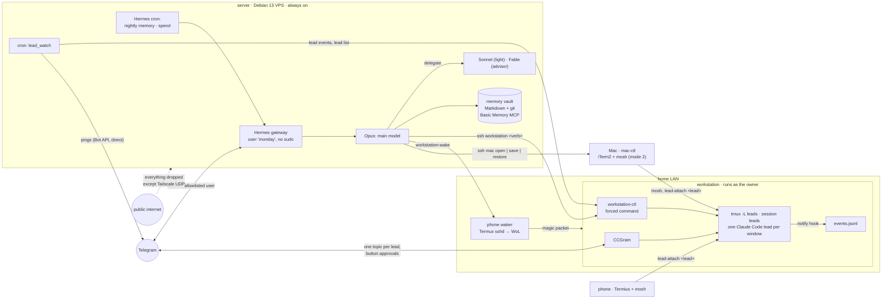

# MyMonday

[](https://github.com/KBT-0/MyMonday/actions/workflows/shellcheck.yml)

**A personal AI work system, built for daily production work.** MyMonday turns a small server, a home
workstation, a laptop and two phones into one always-on setup: an assistant ("Monday") that wakes the
workstation when there is work and powers it off when there is none, runs and supervises several AI
coding leads across projects in parallel, parks them at night and resumes them the next day, and sends
to the phone only the moments that need a human. It switches between two work modes on its own (phone
first, or at the laptop with every lead window restored to its saved layout), keeps an auditable
long-term memory with a source for every fact and a nightly capture of the day's sessions, backs
everything up encrypted off-site, and rebuilds from one idempotent bootstrap with personal values kept
out of git.

It is mostly proven third-party tools, glued together by small scripts you can read in an evening.

## What makes it different

- **Built for daily work rather than as a showcase.** The unit of value is a committed change in a real repo,
  made by a Claude Code lead in that project's own checkout, with that project's own tooling.
- **Composes mature tools instead of reinventing them.** Hermes Agent for the assistant and its
  Telegram gateway, Claude Code for the coding, Basic Memory for the index, CCGram for per-lead
  Telegram topics, tmux + mosh for sessions that survive anything, Tailscale for the network, restic
  for backups. The glue is about 4k lines of bash and Python, tests included (see [Third-party components](#third-party-components)).
- **The human stays in charge, by construction where possible.** Every remote key is a forced command
  (`workstation-ctl`, `mac-ctl`, `wol.py`); root on the workstation is two allow-listed verbs; power-off is
  refused while work runs; the agent kit's state files are the truth (the assistant reads them and changes
  only a usage-limit stop it continues). Pushes and merges wait for the owner (an instruction, stated as
  such below). What the workstation key really amounts to is spelled out in the [Security model](#security-model).
- **Survives real life.** Cold boot through Wake-on-LAN sent by an old phone on the home LAN; leads
  park with a hand-off at night and resume by session id in the morning; usage-limit stops are
  continued after the reset; a crashed lead stays readable instead of vanishing.
- **Two work modes with automatic switching.** Mode 1: the owner drives everything from Telegram and
  gets every question at once. Mode 2: the owner sits at the Mac, the leads open as iTerm2 windows in
  their saved layout, and pings hold back. Mode 2 starts by itself when the owner types in a lead window
  on the Mac (tmux client activity, nothing runs on the Mac) and ends by itself when the Mac goes offline
  or a lead has waited on the owner for 30 minutes.
- **Memory you can audit.** Plain Markdown in git, every fact with `src:` and `by:` provenance,
  `## Current` / `## History`, tombstones instead of deletes, a nightly capture of the day's sessions
  through a secret scanner, encrypted off-site backups.
- **Reproducible, with personal values kept out of the tree.** One idempotent bootstrap with phases;
  secrets are typed into the tools' own config files, personal values into the git-ignored `local.env`;
  neither is in the tracked files (`scripts/check-private.sh` checks the tree and history against your
  `local.env`).
- **Honest about limits.** What a compromised server could do is written down
  ([Security model](#security-model)), and so is every place where a rule is a convention, not a control.

## Quickstart (server and workstation only)

1. `cp local.env.example local.env`, fill in at least `OWNER_NAME`, `SERVER_IP`, `WORKSTATION_HOST`,
   `WORKSTATION_USER`; `chmod 600 local.env`.
2. Server (Debian 13, as root): `bash server/bootstrap.sh <admin>` (base, user, tailscale, agent,
   userland, hermes, persona), then by hand `hermes model` and `hermes gateway setup` as the agent user,
   then `bash server/bootstrap.sh <admin> routing service workstation`. The full guide with hardening,
   memory, ops, backup and lockdown is [`server/README.md`](server/README.md).
3. Workstation (Arch-based Linux, same checkout and `local.env`): `sudo bash workstation/setup.sh <owner>
   monday.pub` with the key the `workstation` phase printed, then `sudo bash workstation/install-root.sh <owner>`;
   check with `bash workstation/test-leads.sh`.
4. From the server: `sudo -iu monday ssh workstation status`, then talk to the assistant on Telegram.

Clients (Mac, phone, phone waker) and the ops jobs are optional: [docs/](docs/).

## Architecture



All links between machines run over Tailscale. The owner reaches the server as the operator account
(sudo with password); the assistant reaches the workstation, the phone and the Mac only through
forced-command keys.

**A day with it.** Morning: the assistant wakes the workstation through the phone, re-pins session
ids, `lead up` resumes every project lead and pastes its hand-off prompt. During the day the owner
answers lead questions from Telegram (CCGram buttons) or sits at the Mac (mode 2, layout restored). In
the evening each lead commits and writes a hand-off, `power-check` confirms nothing runs, the
machine sleeps or powers off; at 00:30 the day's sessions become journal entries in the vault.

Details: [docs/remote-workstation.md](docs/remote-workstation.md) · [docs/leads.md](docs/leads.md) ·
[docs/clients.md](docs/clients.md) · [docs/memory.md](docs/memory.md) · [server/README.md](server/README.md)

## What the bootstrap does

`server/bootstrap.sh <admin> [phase ...]` runs as root on the server. Every phase can be re-run safely.
Personal values come from `local.env` (`cp local.env.example local.env`).

| Phase | Result |
|---|---|
| `base` | Full upgrade, base packages, security-only unattended upgrades (no auto reboot), hostname, timezone, 2 GB swap with `vm.swappiness=10` |
| `user` | Operator account with sudo and the root SSH keys |
| `tailscale` | Tailscale from the official apt repo, interactive `tailscale up` |
| `harden` | sshd: no passwords, no root. ufw: deny incoming, allow `tailscale0` and WireGuard `41641/udp` |
| `agent` | Unprivileged `monday` account for the assistant; `/srv/projects` owned by it (operator uses `sudo -u monday`) |
| `userland` | Node LTS via fnm, Claude Code, for both accounts |
| `hermes` | Hermes Agent, installed with its official installer (read before running) |
| `persona` | Monday's identity (`SOUL.md`, a template filled from `local.env`) and CLI branding |
| `routing` | Opus as main model, Sonnet and Fable as delegation routes |
| `memory` | The memory vault (four git repos with a gitleaks hook, `SCHEMA.md`), Basic Memory as MCP, the vault skill, hourly auto-commit |
| `service` | Gateway as a systemd user service that survives reboots |
| `desktop` | Monday's visible Chromium on Xvfb, viewed over loopback-only x11vnc + noVNC (SSH tunnel); Hermes WebUI on the tailnet via `tailscale serve` |
| `workstation` | Keys and ssh aliases for the workstation, phone waker(s) and Mac; the `workstation` skill; `workstation-wake` |
| `ops` | Lead notifications, spend summary and nightly memory capture: cron block + Hermes cron jobs |
| `backup` | Nightly encrypted restic backup to Cloudflare R2, as root |
| `lockdown` | Operator sudo requires a password, with a 10-minute automatic revert as a safety net |

The workstation side is `workstation/setup.sh`, `install-root.sh` and `install-user.sh`; the clients have
their own install scripts in `clients/`. The step-by-step rebuild guide is in
[`server/README.md`](server/README.md).

## Design decisions

**Reproducible first.** The server is expected to move from arm64 to an x86 host. So nothing was
configured by hand: every change went through the script, over SSH, and was re-run to prove it
is idempotent. Nothing in it is architecture-specific.

**One file of personal values.** Addresses, ids, user names and preferences live in a git-ignored
`local.env`; the scripts read it (the workstation gets a copy in `~/.config/monday/workstation.env`,
the ops jobs in `OPS_DIR`). The repo stays publishable, and a stranger fills in one file.

**No lockout by construction.** The `harden` phase refuses to run unless Tailscale is up *and* the
operator confirms a working Tailscale login (`CONFIRMED_TAILSCALE_LOGIN=yes`). The sshd drop-in is
checked with `sshd -t` before reload, and named `00-…` because sshd keeps the first value it reads.

**The assistant has no root.** Monday runs as its own `monday` account: no sudo, locked password,
no SSH login, and no access to the operator's home. Projects live in `/srv/projects`, owned by
`monday`; the operator works there only as `monday` (`sudo -u monday`), so agent-written git hooks
or scripts cannot run as the operator. When root is needed, Monday hands the operator the command.

**Least privilege at the end, with a dead man's switch.** The unattended phases need password-less
sudo; the final `lockdown` phase removes it, and schedules a 10-minute revert that the operator
cancels only after a successful `sudo` with the password in a new session.

**Secrets never touch the repo, the logs or the automation.** API keys and bot tokens are typed by
the owner into the tools' own prompts or files (`~/.hermes/.env`, `~/.config/monday/ccgram.env`,
mode `600`). The automation checks file modes and key names, never contents.

**Every remote key is a forced command; the workstation key is still effectively a shell as the
owner.** The phone runs only `wol.py` and the Mac only `mac-ctl`. The workstation runs only `workstation-ctl`,
but `workstation-ctl` types text and keys into Claude Code sessions that run as the owner, a helper session's
login shell stays when claude exits, and `send --allow-bang` runs a shell command on purpose. So whoever
holds the server's key can do anything the owner's account can, including adding keys. What stays out of
its reach is what root owns: `workstation-ctl` itself, `monday-root` and its allow lists, the sudoers rules
(sudo needs the owner's password).

**The project's state is the truth.** Leads, hand-offs and kit files belong to the projects; the
assistant reads them and types commands into sessions, but never keeps a second copy that could drift.
The one kit file it changes: `lead up` deletes a usage-limit stop it continues, as the kit's own watchdog
would.

**Notifications that matter.** One small poller turns hook events into Telegram pings with
de-duplication, staleness filtering, reminders and work-mode rules, instead of forwarding every
intermediate message.

**Third-party installers: reviewed once, mostly not pinned.** The `curl | bash` installers (fnm, Claude
Code, Hermes) were read before their first run, but they are fetched live, so a re-run executes whatever
the vendor serves that day. Pinned: gitleaks (release binary, sha256-checked), CCGram (version, and its
local patch refuses an unknown one), Basic Memory (version, on first install), Hermes WebUI (commit).
Tailscale comes from its signed apt repo.

**Security-only automatic updates.** Debian's default unattended-upgrades also applies point
releases; the script replaces its origin list (`#clear`) so only security updates install unattended.

## Model routing

Monday's main model is **Claude Opus 5.5**, which does the actual work. Through Hermes's official
`advanced-delegation` plugin it can hand a subagent to one of two named routes
([`server/hermes/model_map.json`](server/hermes/model_map.json)):

- **`light` → Claude Sonnet 5.5**: routine, high-volume subtasks with a clear goal, to keep cost down.
- **`advisor` → Claude Fable 5.1**: analysis only, for architecture, hard trade-offs and reviews.

"Advice only" is enforced by instruction (route description and `SOUL.md`), not by a sandbox: Hermes
subagents inherit the parent's tools.

## Security model

- **Server.** Monday can run shell commands as `monday`. Content it reads (web pages, forwarded
  messages, files in a repo) could carry a prompt injection that acts with that account's rights: its
  own files, `/srv/projects`, its API keys, and every key it holds (below). The Telegram allowlist
  limits who can talk to it, not what it reads. It cannot reach root or the operator's home.
- **Workstation.** The assistant's key logs in only from the server's tailnet IP and only into
  `workstation-ctl`. But the Claude Code sessions there run **as the owner**, so text the assistant types
  acts with the owner's rights: project files, git keys, project credentials. Treat the key as a shell as
  the owner: a compromised server can make a session read, change or push anything the owner's account
  can, run commands (`send --allow-bang`, a helper session's shell) and add SSH keys. Accepted: the owner uses
  the assistant as remote hands. Mitigations: the owner is out of the `docker` group, sudo needs the
  owner's password (`monday-grant <minutes>` lends it), root actions are allow-listed, power changes go
  through a guard, Telegram-started sessions are limited to the projects root and cannot bypass
  permissions.
- **Phone waker and Mac.** Single-purpose forced commands: wake the workstation; open/arrange lead
  windows. They cannot run anything else and cannot be updated by the assistant.
- **Conventions, not controls.** "Never push without the owner", "ask before root", "advisor gives
  advice only", "brain-sensitive only on request" are instructions to the model. They hold as long as
  the model follows them; the hard boundaries are the accounts, the forced commands and the allow lists.
- **Network.** Port 22 on the public IP is closed (ufw + provider firewall); the provider's web console
  is the break-glass path.

| Rule | Kind | Enforced by |
|---|---|---|
| Assistant has no root on the server | control | separate account, no sudo, locked password |
| Workstation key only from the server, only `workstation-ctl` | control | `authorized_keys` `from=`, `command=`, `restrict` |
| Workstation root limited to two verbs on listed names | control | sudoers regex + `monday-root` + root-owned allow lists |
| Power off/reboot/sleep refused while work runs | control (bypassable) | `monday-leads power-check`; `--force` overrides |
| Text starting with `!` is not sent to a session | control (bypassable) | `workstation-ctl send`; `--allow-bang` overrides |
| Telegram-started sessions: projects root, no permission bypass | control | `lead-claude` |
| Backups unreadable and undeletable by the assistant | control | root-only restic credentials |
| Phone and Mac keys do one thing | control | forced `wol.py` / `mac-ctl` |
| Leads never push or merge without the owner | convention | instructions (skill, `SOUL.md`) |
| Ask before root actions and before `--force` | convention | instructions |
| Advisor route gives advice only | convention | route description, `SOUL.md` |
| `brain-sensitive` opened only on request | convention | `SOUL.md`; the account can read it |
| Nothing the server can do through a session as the owner | none | accepted risk (see Workstation) |

## Third-party components

| Component | License | Used for |
|---|---|---|
| [Hermes Agent](https://github.com/NousResearch/hermes-agent) | MIT | the assistant: Telegram gateway, tools, skills, cron, sessions |
| [Hermes WebUI](https://github.com/nesquena/hermes-webui) | MIT | browser UI for the assistant on the tailnet (pinned commit) |
| [Claude Code](https://docs.anthropic.com/en/docs/claude-code) | proprietary (Anthropic) | the project leads and helper sessions; the models behind Hermes |
| [Basic Memory](https://github.com/basicmachines-co/basic-memory) | AGPL-3.0 | index + MCP server over the Markdown vault (used unmodified, as a separate tool) |
| [CCGram](https://github.com/alexei-led/ccgram) | MIT | Telegram topic per lead window, button approvals (pinned, small local patch in `workstation/ccgram-patches/`) |
| [claude-swap](https://github.com/realiti4/claude-swap) | MIT | switching Claude Code accounts on the workstation (optional) |
| [gitleaks](https://github.com/gitleaks/gitleaks) | MIT | pre-commit secret scan of the vault, nightly export scan, repo checks |
| [restic](https://github.com/restic/restic) | BSD-2-Clause | encrypted, deduplicated nightly backups |
| [Cloudflare R2](https://www.cloudflare.com/developer-platform/r2/) | service | backup storage (S3 API) |
| [Tailscale](https://github.com/tailscale/tailscale) | BSD-3-Clause (client) | private network between all machines |
| [tmux](https://github.com/tmux/tmux) | ISC | the lead server, viewers, helper sessions |
| [mosh](https://github.com/mobile-shell/mosh) | GPL-3.0 | roaming terminal connections from the Mac and phone |
| [iTerm2](https://github.com/gnachman/iTerm2) | GPL-2.0 | Mac terminal driven by AppleScript (layout save/restore) |
| [Termux](https://github.com/termux/termux-app) + [Termux:Boot](https://github.com/termux/termux-boot) | GPL-3.0 | sshd and Wake-on-LAN sender on the phone waker, autostart |
| [Termius](https://termius.com) | proprietary | phone terminal client (any mosh client works) |
| [uv](https://github.com/astral-sh/uv) | Apache-2.0 / MIT | installs Basic Memory and CCGram as pinned tools |
| [fnm](https://github.com/Schniz/fnm) + [Node.js](https://nodejs.org) | GPL-3.0 / MIT | Node runtime for Claude Code and tools |
| [Xvfb](https://www.x.org), [x11vnc](https://github.com/LibVNC/x11vnc), [noVNC](https://github.com/novnc/noVNC) | MIT/X11, GPL-2.0, MPL-2.0 | the assistant's visible browser and its loopback-only viewer |
| [Cloudflare security-audit skill](.claude/skills/security-audit/UPSTREAM.md) | MIT | vendored Claude Code skill for reviews of this repo |

Each tool keeps its own license; this repo only contains configuration and glue, plus the CCGram patch
(MIT, like CCGram) and the vendored skill.

## Roadmap

- [x] Run Hermes as a dedicated user without sudo
- [x] Encrypted restic backups to Cloudflare R2, root-only, with a documented restore path
- [x] Restricted SSH entry for the workstation (forced command, `workstation/`)
- [x] Wake-on-LAN relay at the workstation's home: an old Android phone (Termux sshd, forced command)
- [x] Project leads in tmux with park/resume, notifications and CCGram topics
- [x] Mac client with layout save/restore (work mode 2)
- [x] Memory vault with provenance, nightly capture and auto-commit
- [x] Hetzner Cloud Firewall as a second layer in front of ufw (`server/hetzner/firewall.sh`)
- [ ] Second phone as a backup waker
- [ ] Turkish-aware lexical search upstream in Basic Memory

## Repository layout

```text
local.env.example         every personal value (copy to local.env, git-ignored)
scripts/check-private.sh  fails when a local.env value appears in the tree or the git history
server/
  bootstrap.sh            every system change, in idempotent phases
  README.md               rebuild-from-zero guide
  hermes/
    SOUL.md               Monday's identity and voice (template)
    model_map.json        delegation routes (light, advisor)
    skins/monday.yaml     CLI branding
    skills/workstation/   how Monday drives the workstation (+ references/)
    skills/personal-memory-vault/  how Monday works with the vault (+ references/)
  ops/                    server jobs, installed to OPS_DIR by the ops phase
    lead_watch.py         lead events -> Telegram, work modes 1/2, reminders
    spend_summary.py      daily API spend line (Hermes cron, no agent)
    brain_nightly.py      nightly session export to brain-raw (Hermes cron step 1)
    common.py messages.py config loader, Telegram, texts (en, tr)
    crontab.in            managed crontab block
    tests/                unit tests of lead_watch.py and common.py (python3 -m unittest)
    hermes-cron.sh        Hermes cron jobs (created once)
  memory/
    SCHEMA.md             vault contract template (first run only)
    pre-commit-gitleaks   hook of every vault repo
    brain-autocommit*     hourly commit of the vault (user timer)
  hetzner/                provider firewall via hcloud (run from the operator's machine)
  backup/                 restic backup / restore wrapper + nightly timer (root only)
  workstation/workstation-wake  asks a phone on the workstation's LAN to send Wake-on-LAN
  desktop/*.service       Xvfb, x11vnc, noVNC, Chromium, Hermes WebUI (systemd user units)
workstation/              the workstation side
  setup.sh                forced-command key, poweroff without password, idle-off, monday-grant
  install-root.sh         workstation-ctl, monday-root + sudoers rule (owner substituted)
  install-user.sh         monday-leads, hook, tmux conf, lead env, CCGram, workstation.env from local.env
  workstation-ctl         the forced command: status, sessions, leads, power, root
  monday-leads            project leads registry and lifecycle (park/resume, events, power-check)
  claude-notify.sh        Claude Code hook: lead events + status files
  lead-env, lead-tmux.conf, lead-claude, lead-attach   lead environment, tmux config, Telegram-started claude, viewer
  ccgram.service, ccgram-patches/, monday-leads.service   user units, CCGram patch
  idle-off, monday-root, sudoers-81-monday-root
  test-leads.sh, test-monday-root.sh   tests (fake claude, private tmux socket, dry runs)
clients/
  mac/                    mac-ctl, install.sh, mac-leads.sh (tmux -CC)
  phone/                  Termius/mosh usage
  phone-waker/            Termux setup, wol.py, Termux:Boot script
docs/                     remote-workstation, leads, clients, memory
.claude/skills/security-audit/   Cloudflare's security-audit skill (vendored, MIT)
.github/workflows/shellcheck.yml lint, syntax checks, tests, gitleaks on every push
```

## License

MIT, see [LICENSE](LICENSE). The vendored security-audit skill keeps its own MIT license
(Cloudflare, Inc.) in `.claude/skills/security-audit/LICENSE`.
