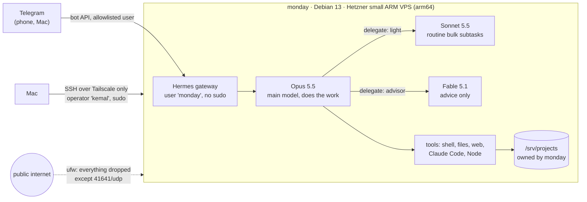

# MyMonday

[](https://github.com/KBT-0/MyMonday/actions/workflows/shellcheck.yml)

**Infrastructure as a script for a personal AI assistant.** MyMonday turns a fresh Debian 13 VPS
into "monday": a hardened, always-on server that runs **Monday**, a
[Hermes Agent](https://hermes-agent.nousresearch.com) assistant I talk to on Telegram. Monday
answers in Turkish, works on the server, and routes work between three Claude models.

The whole server is rebuilt from this repo with one idempotent script. No step is done by hand
except the ones that must be: approving a login and typing a secret.

## Architecture



## What the bootstrap does

`server/bootstrap.sh <user> [phase ...]` runs as root. Every phase can be re-run safely.

| Phase | Result |
|---|---|
| `base` | Full upgrade, base packages, security-only unattended upgrades (no auto reboot), hostname, timezone, 2 GB swap with `vm.swappiness=10` |
| `user` | Operator account with sudo and the root SSH keys |
| `tailscale` | Tailscale from the official apt repo, interactive `tailscale up` |
| `harden` | sshd: no passwords, no root. ufw: deny incoming, allow `tailscale0` and WireGuard `41641/udp` |
| `agent` | Unprivileged `monday` account for the assistant; `/srv/projects` owned by it (operator uses `sudo -u monday`) |
| `userland` | Node LTS via fnm, Claude Code, for both accounts |
| `hermes` | Hermes Agent, installed with its official installer (read before running) |
| `persona` | Monday's identity (`SOUL.md`) and CLI branding |
| `routing` | Opus as main model, Sonnet and Fable as delegation routes |
| `memory` | Basic Memory over the Markdown memory vault, wired into Hermes as MCP |
| `service` | Gateway as a systemd user service that survives reboots |
| `desktop` | Monday's visible Chromium on Xvfb, viewed over loopback-only x11vnc + noVNC (SSH tunnel); Hermes WebUI on the tailnet via `tailscale serve` |
| `backup` | Nightly encrypted restic backup to Cloudflare R2, as root |
| `lockdown` | Operator sudo requires a password, with a 10-minute automatic revert as a safety net |

The step-by-step rebuild guide, including the manual steps, is in [`server/README.md`](server/README.md).

## Design decisions

**Reproducible first.** The server is expected to move from arm64 to an x86 host. So nothing was
configured by hand: every change went through the script, over SSH, and was re-run to prove it
is idempotent. Nothing in it is architecture-specific.

**No lockout by construction.** The `harden` phase refuses to run unless Tailscale is up *and* the
operator confirms a working Tailscale login (`CONFIRMED_TAILSCALE_LOGIN=yes`). The sshd drop-in is
checked with `sshd -t` before reload. The sshd drop-in is named `00-…` because sshd keeps the
first value it reads, and cloud images ship their own drop-ins.

**The assistant has no root.** Monday runs as its own `monday` account: no sudo, locked password,
no SSH keys, and no access to the operator's home. Projects live in `/srv/projects`, owned by
`monday`; the operator works there only as `monday` (`sudo -u monday`), never with its own
identity, so agent-written git hooks or scripts cannot run as the operator. When root is needed,
Monday hands the operator the command. A prompt injection can only act with the rights of that one account.

**Least privilege at the end, with a dead man's switch.** The unattended phases need password-less
sudo; the final `lockdown` phase removes it. It refuses to run unless the operator has a password and
confirms knowing it, and it schedules a 10-minute revert that the operator cancels only after a
successful `sudo` with the password in a new session.

**Secrets never touch the repo, the logs or the automation.** API keys and the bot token are typed
by the owner into Hermes's own prompts in an SSH session. They live in `~/.hermes/.env` and
`auth.json` (mode `600`). The automation checks file modes, never contents.

**Third-party installers are read before they run.** Each `curl | bash` in the script (fnm, Claude
Code, Hermes) was downloaded and reviewed first; Tailscale is installed from its apt repo instead.
The one Hermes plugin used (`advanced-delegation`) was reviewed at its pinned commit and the
installed files were hash-compared with that review.

**Security-only automatic updates.** Debian's default unattended-upgrades also applies point
releases; the script replaces its origin list (`#clear`) so only security updates install unattended.

## Model routing

Monday's main model is **Claude Opus 5.5**, which does the actual work. Through Hermes's official
`advanced-delegation` plugin it can hand a subagent to one of two named routes
([`server/hermes/model_map.json`](server/hermes/model_map.json)):

- **`light` → Claude Sonnet 5.5**: routine, high-volume subtasks with a clear goal, to keep cost down.
- **`advisor` → Claude Fable 5.1**: analysis only, for architecture, hard trade-offs and reviews.
  Opus asks, Fable answers, Opus acts.

The model only sees route names and descriptions, never providers or keys. "Advice only" is
enforced by instruction (route description and `SOUL.md`), not by a sandbox: Hermes subagents
inherit the parent's tools. That trade-off is documented rather than hidden.

## Known risks

- Monday can run shell commands as `monday`. Content it reads (web pages, forwarded messages) could
  carry a prompt injection that acts with that account's rights: its own files, `/srv/projects`, and
  its API keys. The Telegram allowlist limits who can talk to it, not what it reads.
- Port 22 on the public IP is closed; the provider's web console is the break-glass path.

## Roadmap

- [x] Run Hermes as a dedicated user without sudo
- [x] Encrypted restic backups to Cloudflare R2, root-only, with a documented restore path
- [x] First backup run against the real R2 bucket
- [ ] Restricted SSH entry for a second machine (forced command)
- [x] Hetzner Cloud Firewall as a second layer in front of ufw (`server/hetzner/firewall.sh`)

## Repository layout

```text
server/
  bootstrap.sh            every system change, in idempotent phases
  README.md               rebuild-from-zero guide
  hermes/
    SOUL.md               Monday's identity and voice
    model_map.json        delegation routes (light, advisor)
    skins/monday.yaml     CLI branding
  hetzner/
    firewall.sh           provider firewall via hcloud (run from the operator's machine)
    firewall-rules.json   inbound: Tailscale UDP 41641 and ICMP only
  backup/
    mymonday-backup       restic backup / restore wrapper (root only)
    mymonday-backup.*     systemd service + nightly timer
  memory/
    brain-autocommit      hourly commit of the memory vault (runs as monday)
    brain-autocommit.*    systemd user service + timer
  desktop/
    *.service             Xvfb, x11vnc, noVNC, Chromium, Hermes WebUI (systemd user units)
.claude/skills/
  security-audit/         Cloudflare's security-audit skill (vendored, MIT; see UPSTREAM.md)
.github/workflows/
  shellcheck.yml          lint on every push
```

Claude Code picks up the security-audit skill when working in this repo: security questions and
focused reviews use it as guidance; a full multi-phase audit runs only when asked for explicitly.

## License

MIT, see [LICENSE](LICENSE). The vendored security-audit skill keeps its own MIT license
(Cloudflare, Inc.) in `.claude/skills/security-audit/LICENSE`.
