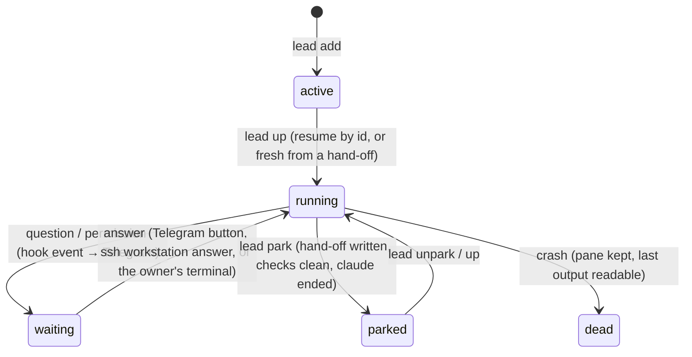

# Leads: Claude Code project sessions that outlive the owner's attention

A **lead** is a long-running Claude Code session responsible for one project (or one task in a
worktree). Leads live on the workstation as windows of a single tmux session, `leads`, on a private
tmux server (`tmux -L leads`). Everything else (the assistant, CCGram, the owner's devices) attaches
to that one place.

## Pieces (`workstation/`)

| File | Role |
|---|---|
| `monday-leads` | registry (`~/.config/monday/leads.json`) and lifecycle: `add/rm/set`, `up`, `park/unpark`, `check`, `status --json`, `events`, `power-check`, `viewers`, `stopall` |
| `claude-notify.sh` | Claude Code hook: writes lead events (`permission`, `question`, `stop`, `failure`, `ended`, `prompt`, `answered`) to `~/.local/state/monday/events.jsonl` and per-lead status files; never the prompt text |
| `lead-env` | login-like environment for a lead started by systemd or SSH (PATH, node, ssh-agent socket, pinned Claude version, no auto-update) |
| `lead-tmux.conf` | names stay fixed (`allow-rename off`), big history, mouse, OSC 52 clipboard |
| `lead-claude` | the `claude` CCGram starts for a session opened from Telegram: projects root only, refuses permission-bypass flags, registers the folder as a lead |
| `lead-attach` | the owner's viewer: `lead-attach NAME` opens a grouped `view-*` session (own window choice per device, gone on detach) |
| `ccgram.service`, `ccgram-patches/` | CCGram user unit (one Telegram topic per lead window, button approvals) and a small local patch: one button per menu option, prompts ahead of the queue |
| `monday-leads.service` | optional: `up` at boot |
| `test-leads.sh` | tests against a fake claude on a private tmux socket and a throwaway HOME |

## Lifecycle



- **up** starts active leads in `order`, waits for each prompt and verifies after a few seconds that the
  pane still runs claude (a crash is reported with its last output; the window stays so the Telegram
  topic survives). A lead resumes its session by id unless a newer hand-off exists or it was parked for a
  day or more, then it starts fresh and is told to read the hand-off.
- **park** asks for a hand-off and refuses to end claude while the checkout has uncommitted work, a
  merge/rebase in progress or stale locks (`--force` overrides on the owner's word).
- **Resume across days:** at night every lead writes a hand-off and a next-session prompt; the
  machine sleeps or powers off; in the morning `lead up`, then `/clear` and the saved prompt. Session
  ids change with `/clear`, so they are re-pinned (`lead set NAME session_id=...`) before shutting down.
- **Usage limits:** a lead stopped by a usage limit records when it resets; the assistant runs
  `lead up NAME` after that time instead of a watchdog starting sessions outside tmux.

## Agent kit (optional)

Some projects run a coordination kit: a Claude Code plugin that keeps lead state in files inside the
project (`$LEADS_KIT_DIR`, default `.agentkit`): who the master writer is (session id + SendMessage
name), a pending hand-off, a usage-limit stop, background workers and their results, nightly reports.
monday-leads reads these files and types the kit's slash commands (`$LEADS_KIT_CMD:handoff`,
`$LEADS_KIT_CMD:mode autopilot|present`); the kit's state is the truth and is never copied. The one
file it changes is `limit-stop`: `lead up` deletes it when it continues that usage-limit stop, as the
kit's own watchdog would. Projects without a kit use the registry's own fields.

File contract (all under `<project main checkout>/$LEADS_KIT_DIR/`; any kit that writes these works):

| File | Format | Used for |
|---|---|---|
| `master-writer` | line 1 session id, line 2 SendMessage name; empty or missing = released | which session to resume; park waits for release |
| `handoff-pending` | `HANDOFF_PATH COMMIT` (path relative to the checkout) | start fresh from that hand-off; park waits for a newer one |
| `limit-stop` | `RESETS_AT ORG HANDOFF` (epoch seconds, account label, hand-off path) | `up` refuses before RESETS_AT, then continues and deletes the file |
| `workers/NAME.state` | first word = state (`idle`, `working`, ...) | `status --json` workers |
| `workers/NAME.live` | pid of a running worker | power guard; the notify hook treats a live one as "lead not done" |
| `workers/NAME.result.md` | a `Kind: <word>` line | `status --json` result kind |
| `autopilot/YYYY-MM-DD.md` | nightly report | newest one in `status --json` |
| `*.lock` | flock-held by a live pid | power guard |
| `scripts/working_mode.py` (in the checkout) | prints the mode on line 1 and an `Owner: <name>` line | `status --json` mode and owner |

## Notifications

```
claude (lead window) ─hook→ events.jsonl ─ssh workstation lead events OFFSET→ lead_watch.py (server cron, 1/min) ─→ Telegram
```

- **Mode 1** (default, the owner works through Telegram): every question, permission, finished turn,
  failure and ended session is pushed at once. Only registered leads; events older than 30 min are
  dropped (no flood after a wake); a later prompt or answer cancels a pending one. Notices go to an outbox
  saved with the event offset and are sent afterwards; a failed send is retried next run, so a Telegram
  error loses nothing and a crash repeats nothing. A finished turn while a background task or an agent-kit
  worker runs is not a "done" (the hook marks it `bg`).
- **Mode 2** (the owner sits at the Mac terminals): only failures at once; a finished turn is reported
  after 15 min without a new prompt, a question/permission through the reminder. Mode 2 ends by itself
  when the Mac drops off the tailnet (asked from the server: no polling of the Mac) or a lead has really
  waited on the owner 30+ min since mode 2 began: a question or permission prompt, or a finished turn
  whose screen shows nothing running. The message names who is waiting.
- **Reminders:** a lead waiting on a question or permission (its state in `lead list`) is reminded after
  15 min, then every 30 min.
- **Silent failures covered:** a lead whose claude is gone without a session-end event (crash, kill) gets
  one notice; the workstation unreachable over ssh for 30+ min while Tailscale shows it online gets one
  notice. Off or asleep stays silent; if Tailscale itself is down on the workstation, a broken ssh looks
  the same and stays silent too.
- **CCGram** carries the detail (full messages, per-option buttons) in one topic per lead; its group can
  stay muted because the assistant's own pings cover what needs attention.

## Why tmux, one session, one server

- One tmux server owned by the owner: the assistant, CCGram and every device see the same panes.
  Nothing is "remote-controlled" through a vendor service, and nothing depends on a terminal window.
- One session with a window per lead: CCGram binds topics per window of one session, and window names
  are the stable identifiers everything else uses.
- Grouped viewer sessions instead of attaching to `leads`: each device can look at a different lead
  without moving anyone else's view.
- Dead panes are kept (`remain-on-exit`): a crashed lead stays readable and its Telegram topic survives.
