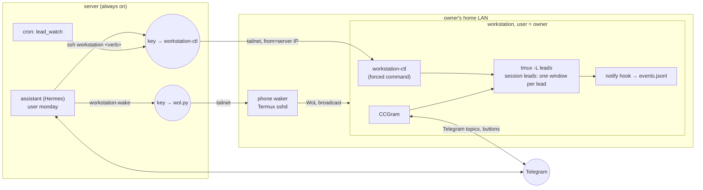

# Remote workstation

The server assistant drives a Linux workstation at the owner's home: it wakes it, runs Claude Code
project leads on it, relays their questions to Telegram, parks them at night and powers the machine
down. The workstation is the owner's real desktop (here CachyOS + Hyprland); the leads run as the
owner, with the owner's Claude accounts, git keys and project credentials.



## Install

On the server (`local.env`: `WORKSTATION_HOST`, `WORKSTATION_USER`, `SERVER_IP`, optional `WORKSTATION_PHONE1/2`, ...):

```sh
sudo bash server/bootstrap.sh <admin> workstation   # assistant keys, ssh aliases, skill, workstation-wake
sudo bash server/bootstrap.sh <admin> ops       # lead_watch cron, Hermes cron jobs
```

On the workstation, from a checkout with the same `local.env` (`WORKSTATION_PROJECTS`, `LEADS_KIT_*`,
`TELEGRAM_USER_ID`, `SERVER_IP`, optional `NOTIFY_LANG`, `LEAD_CLAUDE_VERSION`, `WORKSTATION_CCGRAM`):

```sh
sudo bash workstation/setup.sh <owner> monday.pub     # forced-command key, sudo for poweroff/suspend, idle-off, monday-grant
sudo bash workstation/install-root.sh <owner>         # workstation-ctl, monday-root + allow lists + sudoers rule
bash workstation/install-user.sh                      # (also run by setup.sh) monday-leads, hook, tmux conf, CCGram
bash workstation/test-leads.sh && bash workstation/test-monday-root.sh
```

Requirements on the workstation: tmux, jq, python3, git, Claude Code (native installer), uv (for
CCGram), mosh (for clients), Tailscale. Then the phone waker (`clients/phone-waker/`) and,
optionally, the Mac (`clients/mac/`).

CCGram's secrets (`TELEGRAM_BOT_TOKEN`, `CCGRAM_GROUP_ID`) go into `~/.config/monday/ccgram.env`
(mode 600) by hand; `install-user.sh` adds the non-secret settings and enables the unit once the file
exists. Use a separate bot from the assistant's.

## Command surface

Everything the server can do on the workstation is one script, `workstation-ctl`, run as the forced command
of the server's key (`from="<server tailnet IP>",command="/usr/local/bin/workstation-ctl --ssh",restrict`):
status, projects, helper sessions (`start/read/send/answer/key/stop`), `lead ...` (see
[leads.md](leads.md)), `sleep/off/reboot` behind a power guard, `root pkg-install|service-restart`
for allow-listed names only. Every word is validated by regex and `workstation-ctl` never evaluates its
input as shell code; journald logs verbs and names but never the text sent. What it types, though, lands
in sessions running as the owner: a Claude Code prompt, the login shell of a helper session once claude
exits, and `send --allow-bang` text runs as a shell command on purpose. The key is effectively a shell
as the owner (see Security model).

Owner-specific verbs that do not belong in this repo are extensions: an executable
`/etc/workstation-ctl.d/<verb>` (verb `^[a-z][a-z0-9-]{0,30}$`) runs for any verb that is not built in, with
the remaining words as arguments, stdin passed through and the same environment as built-in verbs.
`workstation-ctl help` lists the installed ones. It runs only if the directory and the file are owned by
root and not group- or world-writable, and the file is a regular executable (no symlink); otherwise the
verb is unknown. `install-root.sh` creates the empty directory. An extension validates its own arguments.

## Power

- **Wake:** `workstation-wake` asks the phone waker (Wake-on-LAN cannot cross the internet).
- **Guard:** `off`, `reboot`, `sleep` and the idle timer refuse while a Claude session or background
  worker is working or waiting on a question, or a kit lock is held by a live pid
  (`monday-leads power-check`). Idle sessions do not block: transcripts are on disk and resume by id.
  `--force` exists for the owner's explicit word.
- **Idle-off:** a root timer powers off after 24 awake hours with no lead or helper session running
  claude, no running claude work or held kit lock, no interactive SSH or mosh login and no active desktop
  (monotonic clock: days of suspend never count as idle). The server's per-minute poll, CCGram and dead
  panes do not keep the machine on. A logged-in desktop counts as active unless logind reports it idle or
  locked (an idle daemon or screen locker sets that); without one, a desktop session keeps the machine on.
- **Sleep vs off:** suspend keeps open windows and sessions; a cold boot is used when nothing needs to
  survive.

## Security model

What the server's workstation key can do, by construction:

- Log in only from the server's tailnet address, only into `workstation-ctl`; no login shell of its own, no
  forwarding, no pty. Through the sessions below it is still effectively a shell as the owner.
- Type into Claude Code sessions that run **as the owner**. This is the accepted, central risk: text the
  assistant sends acts with the owner's rights (projects, git keys, credentials those projects hold).
  A compromised server, or a prompt injection that steers the assistant, can therefore instruct a lead
  to read or change anything the owner's account can, push code with the owner's keys, run commands
  (`send --allow-bang`, a helper session's shell) and add SSH keys to the owner's account.
- Root: only `pkg-install` / `service-restart` of names the owner put in `/etc/monday-root/*.allow`,
  enforced twice (sudoers regex + monday-root). Power off/reboot/suspend via sudo without password.
  Anything else needs the owner's password; `monday-grant <minutes>` lends password-less sudo for a
  limited time when the owner types it.
- Extensions: only what root installed in `/etc/workstation-ctl.d`. The server's key cannot add or
  change one (the directory and files must be root-owned and not writable by others), so it is an
  extension point for the owner, not a way for the server to widen its own command surface. An extension
  runs as the owner with the words the server sent: treat them as untrusted input.

Mitigations: the owner is out of the `docker` group (= root); sudo needs the owner's password; leads
work on branches and never push without the owner (a rule the assistant follows, not a hard control);
Telegram-started sessions are limited to the projects root and refuse permission bypass flags; the
key cannot change `workstation-ctl`, `monday-root`, the allow lists or the sudoers rules (root-owned; sudo
needs the owner's password); the phone and Mac keys are forced to single-purpose scripts that cannot
update themselves. Not mitigated: anything a
Claude session can do as the owner. Keep high-value credentials (password manager, cloud root keys)
out of the owner's shell environment on this machine, or use a separate workstation account for leads.
